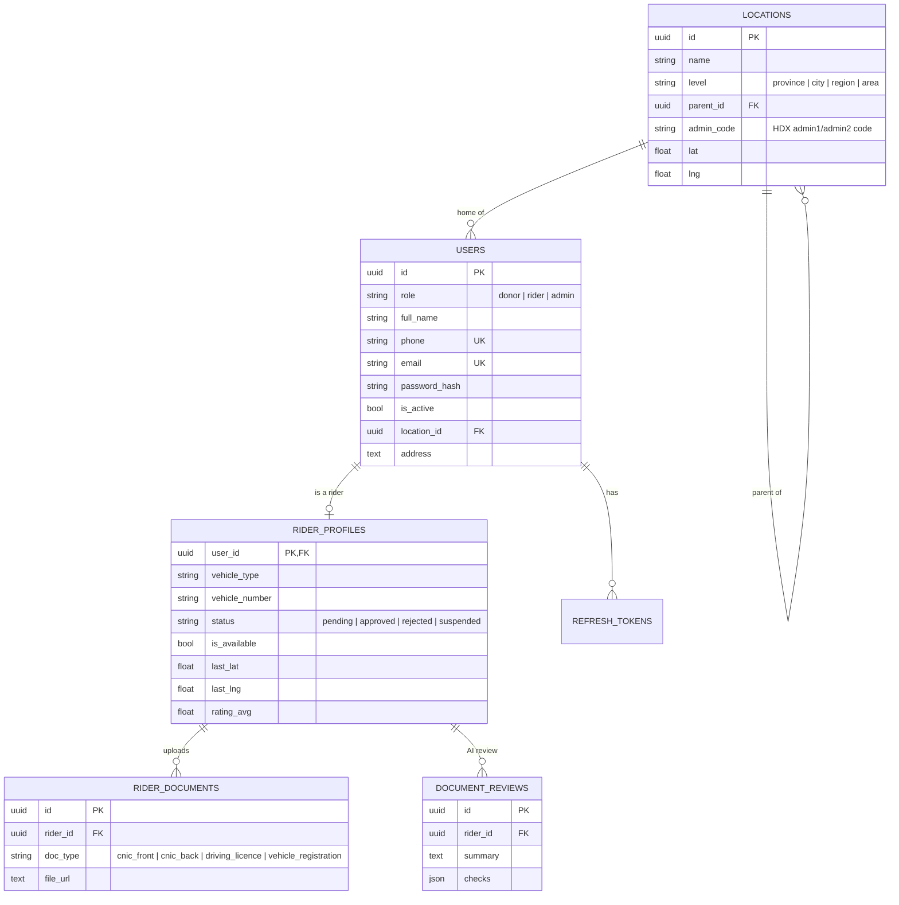
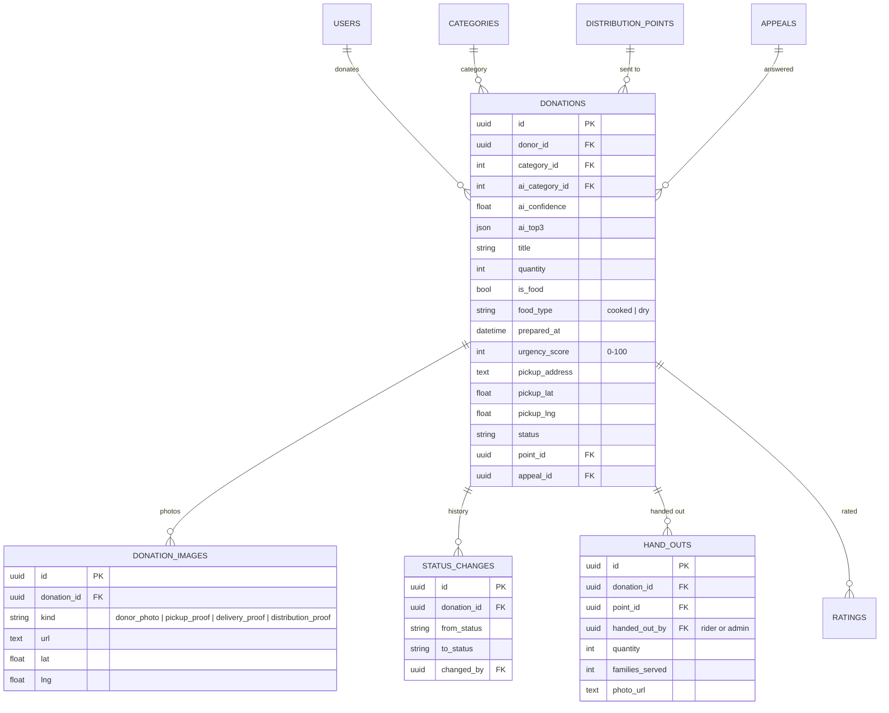
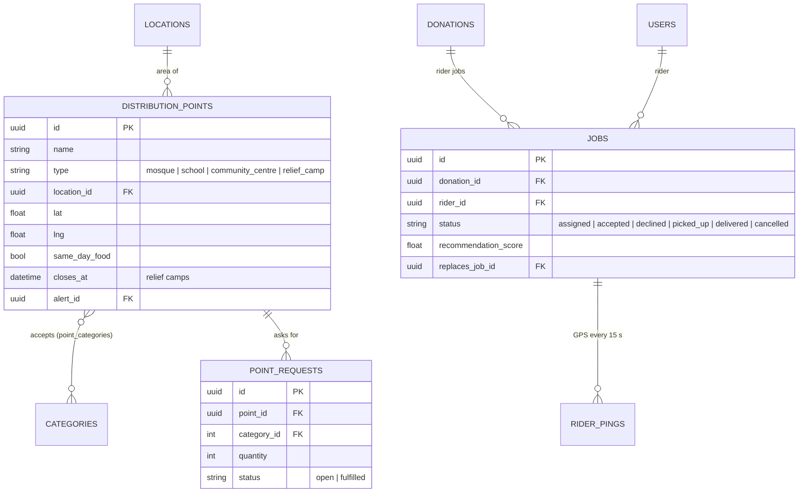
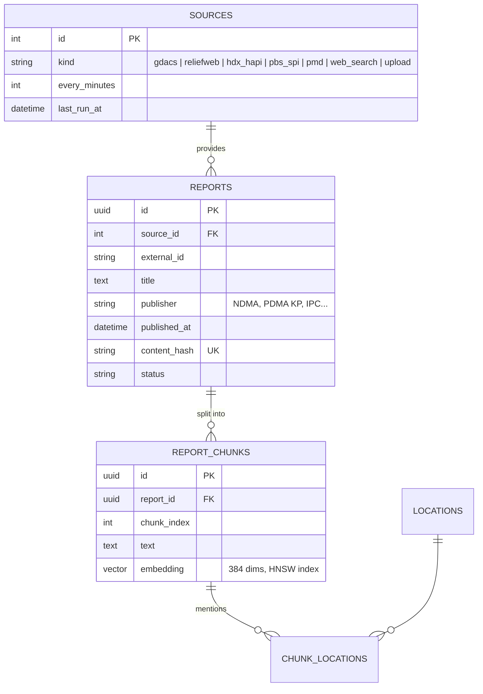
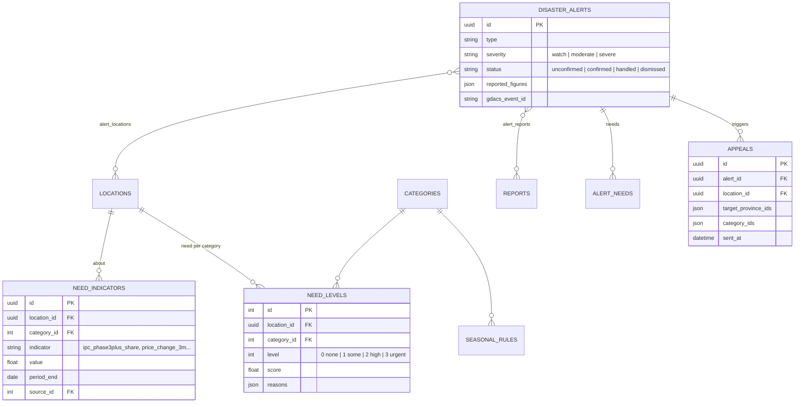

# RAAZICID database design (ERD)

PostgreSQL on Neon with the **pgvector** extension. 31 tables in 6 groups. The source of truth
is the code in `backend/app/models/`; this page explains it. GitHub draws the diagrams below automatically.

Conventions
- Primary keys are UUIDs (safe in URLs), except small fixed tables (`categories`, `sources`) and
  high-volume logs (`rider_pings`, `need_levels`) which use integers.
- Fixed value lists (roles, statuses, types) are stored as text; the allowed values are in
  `backend/app/models/enums.py`.
- Every main table has `created_at` / `updated_at`.

## 1. People and places

**Location tree:** Sindh › Karachi › Karachi South › Lyari. Rural districts from IPC / HDX data
(e.g. Tharparkar, Kech) are stored as `region` directly under their province, matched by `admin_code`.

## 2. Donations

## 3. Logistics

## 4. RAG knowledge base

## 5. Needs, seasons, disasters

## 6. Trust and messages

`notifications` (one row per in-app message, with `data` for deep links) and `fraud_flags`
(rule code, severity, the entity it points at, evidence, review status). Flags are warnings only.

## Key rules the database supports

- **Only approved riders take jobs:** `rider_profiles.status = approved`.
- **Every status move is recorded** in `status_changes` (who, when, from, to).
- **A reassignment keeps history:** a new `jobs` row with `replaces_job_id`.
- **Web-search alerts start as `unconfirmed`;** appeals are always created by an admin (`appeals.created_by`).
- **Need levels are computed, not typed:** `need_levels` is rebuilt from `need_indicators`,
  `seasonal_rules`, alerts, point requests and deliveries, and keeps the `reasons` shown in the UI.
