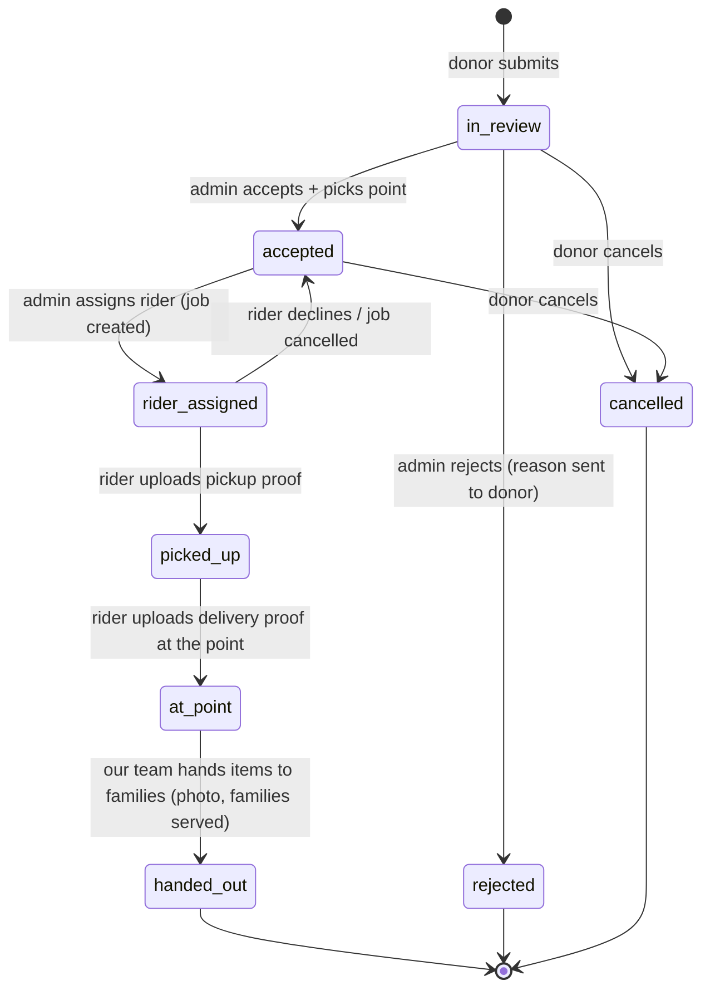

# Donation status flow

| From | To | Who can do it | Saved with it |
|---|---|---|---|
| — | in_review | Donor | photos, AI category suggestion, urgency score (food) |
| in_review | accepted | Admin | distribution point |
| in_review | rejected | Admin | reason |
| accepted | rider_assigned | Admin | job (rider, recommendation score) |
| rider_assigned | accepted | Rider (decline) or Admin (cancel job) | decline reason |
| rider_assigned | picked_up | Rider | pickup proof photo + GPS |
| picked_up | at_point | Rider | delivery proof photo + GPS (flag if far from point) |
| at_point | handed_out | Rider or Admin | hand-out record: quantity, families served, photo |
| in_review / accepted | cancelled | Donor | — |

Every move writes a `status_changes` row and sends notifications:
donor on every move; rider on assign / cancel; admin on decline, stall (no GPS movement) and flags.
