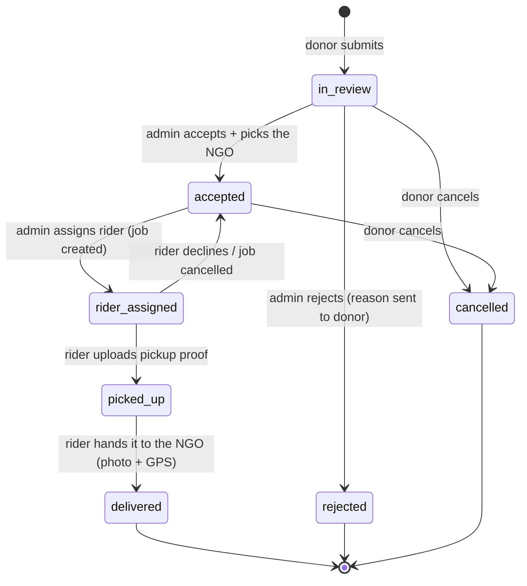

# Donation status flow

| From | To | Who can do it | Saved with it |
|---|---|---|---|
| — | in_review | Donor | photos, AI category suggestion, urgency score (food) |
| in_review | accepted | Admin | the NGO it goes to (found by web search or added by an admin) |
| in_review | rejected | Admin | reason |
| accepted | rider_assigned | Admin | job (rider, recommendation score) |
| rider_assigned | accepted | Rider (decline) or Admin (cancel job) | decline reason |
| rider_assigned | picked_up | Rider | pickup proof photo + GPS |
| picked_up | delivered | Rider | delivery proof photo + GPS at the NGO (flag if far; if the NGO's office was only known by its city, the GPS becomes its location) |
| in_review / accepted | cancelled | Donor | — |

Every move writes a `status_changes` row and sends notifications:
donor on every move; rider on assign / cancel; admin on decline, stall (no GPS movement) and flags.

RAAZICID does not hand out donations itself: `delivered` is the last step, and the NGO gives the items to people in
need. (Before October 2026 there were our own distribution points, relief camps and a `handed_out` step; migration
0003 turned `at_point` and `handed_out` into `delivered` and removed those tables.)
